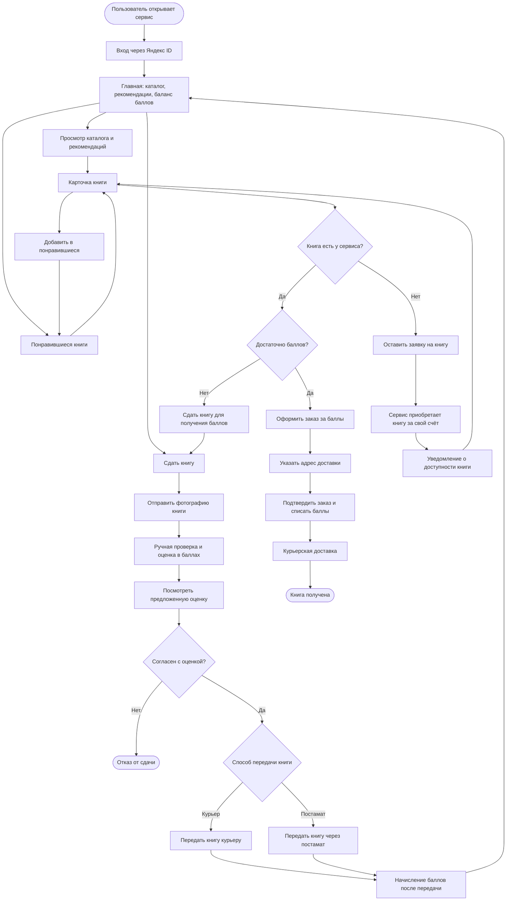

# User flow MVP сервиса букшеринга

Источник: [idea.md](idea.md). Диаграмма описывает обмен книг за баллы. Подписочный прокат — следующий этап, его условия в исходном описании пока не определены.

## Допущения для связности сценария

- Вход показан до каталога; возможность просмотра без авторизации не описана.
- Пользователь может согласиться с оценкой или отказаться от сдачи.
- При недостатке баллов пользователь возвращается к сдаче книги; другие способы пополнения не описаны.
- Адрес, подтверждение заказа и момент списания баллов добавлены как предполагаемые шаги оформления.
- После покупки книги по заявке предполагается уведомление и обычный заказ за баллы. Исходное описание не уточняет, резервируется ли книга за заявителем.

## Переходы, требующие уточнения

- Отказ в приёмке книги и расхождение состояния с фотографией.
- Ошибка входа, отмена заказа, недоступность книги во время оформления и неудачная доставка.
- Срок выполнения заявки на отсутствующую книгу.
- Остаётся ли полученная книга у пользователя или должна быть возвращена.
